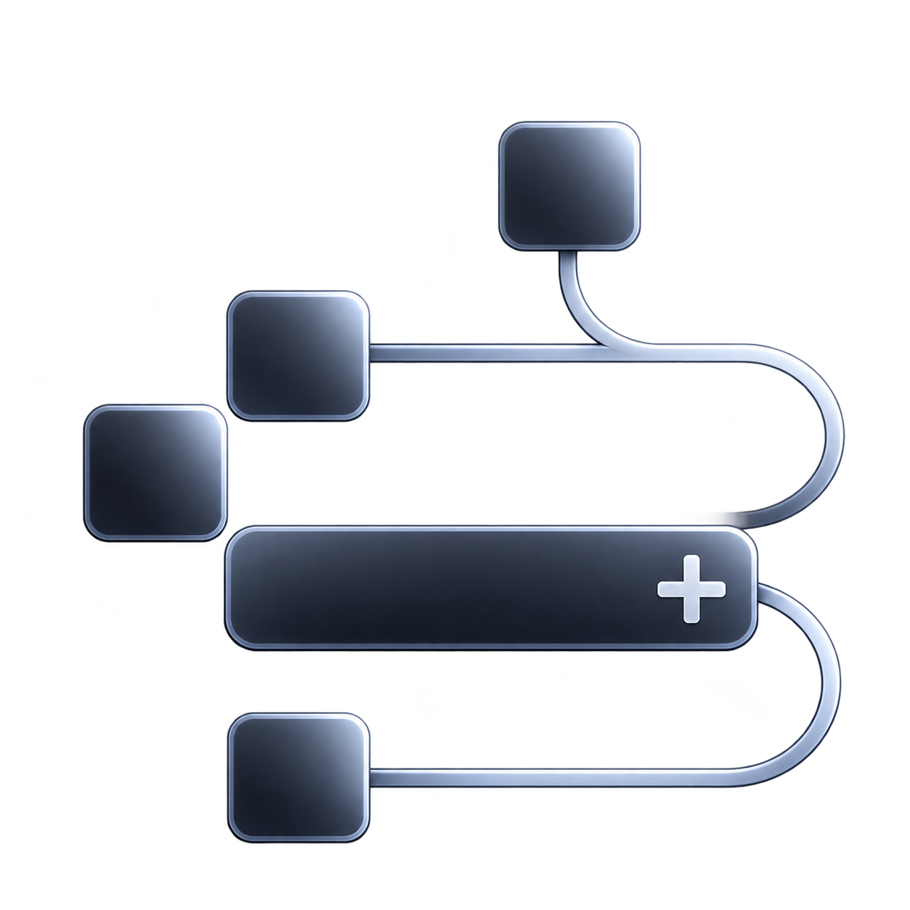
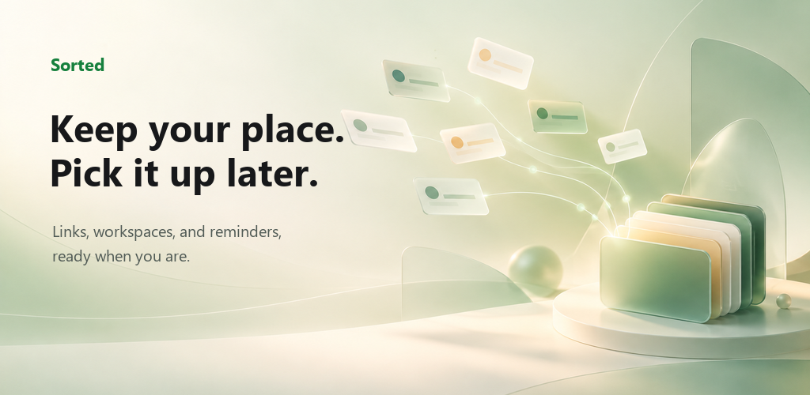
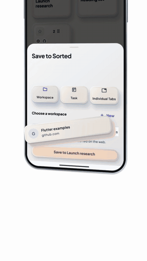
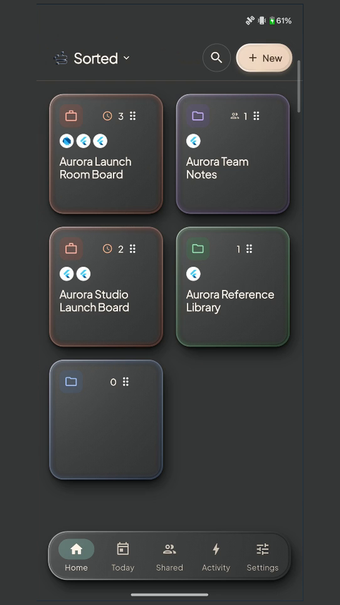
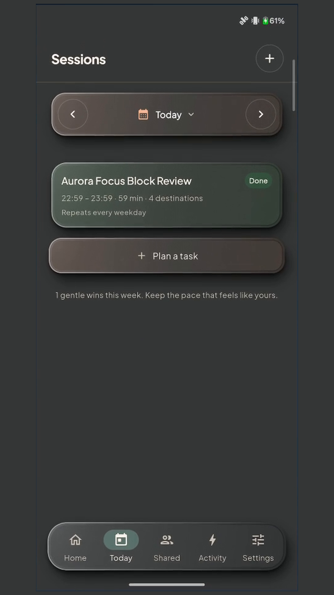
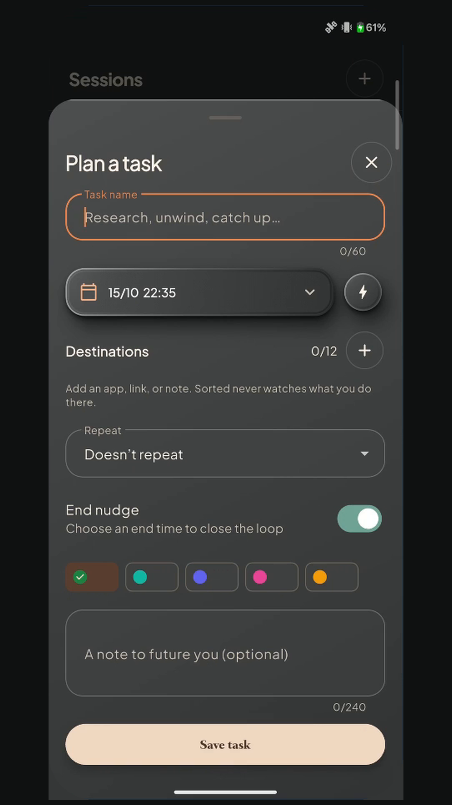
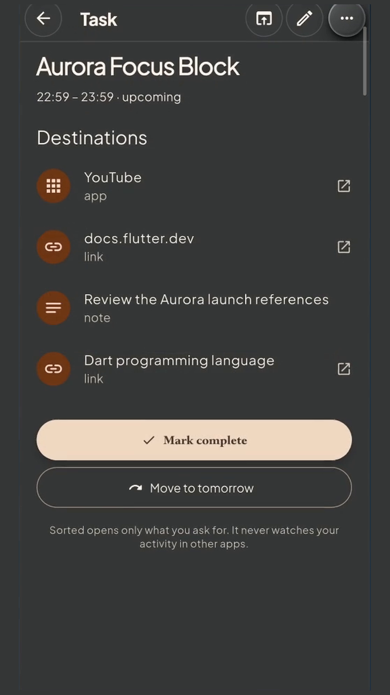
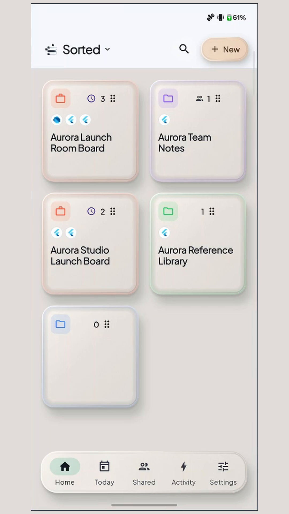

  

<h1 align="center">Sorted Mobile</h1>

<b>Keep your place. Pick it up later.</b> 
The Android companion to Sorted: save links as workspaces, get reminded when to come back, and plan phone time with intention.

  <a href="https://play.google.com/store/apps/details?id=com.sorted.mobile">Google Play</a> ·
  <a href="https://sorted-tab.in">Website</a> ·
  <a href="https://github.com/AaKaShhhhhhhhh/sorted-showcase">Sorted (browser)</a> ·
  <a href="https://github.com/AaKaShhhhhhhhh/sorted-scan-showcase">Sorted Scan</a>

  

> **Production code is private.** This repository is a public product showcase with screenshots, a launch video and an overview. It contains no source code.

---

## The idea

Phones are where good intentions go to scroll. You find a link you mean to read, open an app "for a minute," and the plan is gone. Sorted Mobile gives those intentions a place to live and a time to come back.

## What it does

- **Workspaces in your pocket.** The same workspaces you save in the Sorted browser extension, synced to your phone.
- **Save from anywhere.** Share a link from any app straight into a workspace.
- **Reminders that bring things back.** Pick a time for a workspace or a single link, and Sorted brings it forward then.
- **Sessions for phone time.** Plan a time window with the apps, links, or notes you mean to use. A gentle nudge opens and closes the session.
- **Home-screen widgets.** Today's sessions, the next session, a session calendar, workspace shortcuts, upcoming reminders, and quick actions.
- **Activity and sharing.** See recent changes and workspaces shared with you.
- **Calm by design.** System, light, or dark appearance and a Reduce motion setting.
- **Private by default.** Sorted never tracks which apps you use. It plans the attention you choose to give.

---

## Launch video

   
  <b>Launch film</b> (30s) — <a href="media/video/sorted-mobile-launch.mp4">watch the full video</a>

---

## Screenshots

<table>
  <tr>
    <td></td>
    <td></td>
    <td></td>
    <td></td>
    <td></td>
  </tr>
  <tr>
    <td align="center">Workspaces</td>
    <td align="center">Today's sessions</td>
    <td align="center">Plan a session</td>
    <td align="center">Session destinations</td>
    <td align="center">Light theme</td>
  </tr>
</table>

---

## Tech stack

| Area | Technologies |
|---|---|
| App | Flutter, Dart |
| State | Provider |
| Accounts and sync | Firebase Authentication, Google Sign-In, Cloud Firestore |
| Notifications | Firebase Cloud Messaging, local scheduled notifications |
| Security | Firebase App Check, secure on-device storage |
| Android | Home-screen widgets, share-to-app intents, deep links |

## The Sorted family

| Product | What it is |
|---|---|
| [**Sorted**](https://github.com/AaKaShhhhhhhhh/sorted-showcase) | Browser extension + web dashboard for tab workspaces |
| **Sorted Mobile** (this page) | Android companion: saved links, reminders, and planned phone time |
| [**Sorted Scan**](https://github.com/AaKaShhhhhhhhh/sorted-scan-showcase) | Android document scanner and PDF editor on the same account |

## My role

Co-founder of Sorted and lead developer of Sorted Mobile. I built nearly all of the app, including the home-screen widgets, reminders and sessions, and account sync with the Sorted website.

---

© Sorted. Screenshots and videos are shared for portfolio purposes. All rights reserved.

